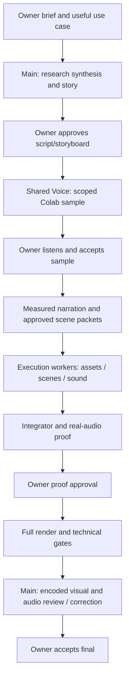

# How I built the video workflow

I designed a reusable Hermes content-production workflow that combines creative direction, smaller execution workers, reusable animation tools and my reference-conditioned Burmese narration.

## The important decision

The main agent owns thinking: who the video helps, the AI-agent use case, the hook, beginner explanation, storyboard, visual changes, pacing and sound. Workers implement small complete packets with fixed inputs/outputs. Their report is a claim until the main checks the files and actual encoded result. This addresses repetitive scenes, paragraph-heavy slides and workers exhausting a turn on an oversized assignment.

Workers may run in parallel for independent evidence/asset/scene tasks; shared browser, voice runtime and final renderer have one owner. Dependent stages remain sequential. A QA job belongs to the main review loop; it does not require a permanent QA bot.

## Voice and compute

Standalone Voice and Creator share one driver. Approved text is chunked into natural phrases; raw clips are preserved, pauses are explicit, sample counts drive visuals and a speech-only envelope drives stylized mouth motion. VoxCPM2 uses reference conditioning, not a newly trained voice model. Owned Colab T4 compute avoids requiring a large local GPU, subject to availability. Interruptions recover durable state rather than silently synthesizing again.

## What I verify

Source/input hashes, scope/ownership, typography and bounds, real object state changes, narrative repetition, caption/presenter collisions, complete audio transport, duration/frame counts, encoded decode, sound balance and actual listening coverage. Automatic gates cannot judge factual truth, voice likeness or creative quality by themselves.

## Portfolio evidence and limits

[Five published style samples](VIDEO_SAMPLES.md) show historical owner-directed output. This release exports source and setup templates. Offline fixtures are rerunnable; they are not a fresh five-style unattended Hermes/Colab certification. Model capacity, free GPU availability, browser access, upstream versions and asset rights remain environmental constraints. No audience-growth or campaign-performance claims are made.

Victor: workflow architecture, creative direction, acceptance criteria and AI-assisted implementation/revision. Upstream frameworks are credited separately.
